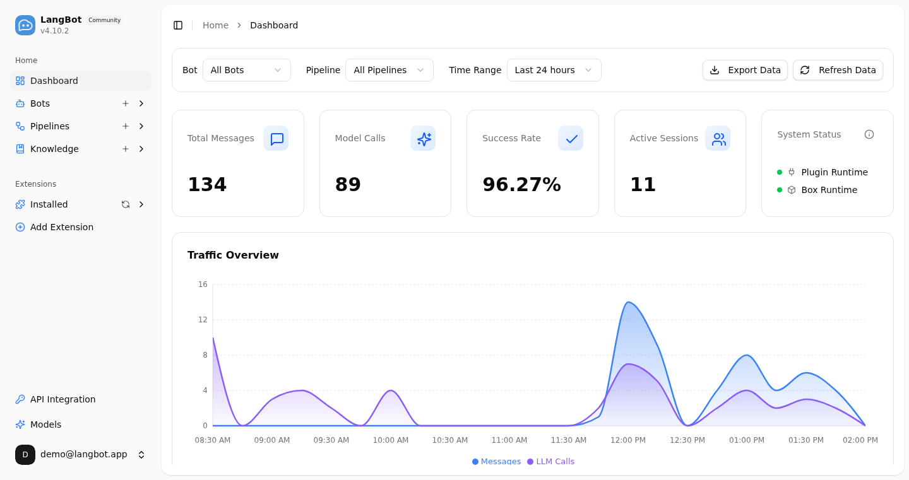

<p align="center">
<a href="https://langbot.app">

</a>

<div align="center">

<a href="https://www.producthunt.com/products/langbot/launches/langbot?embed=true&amp;utm_source=badge-featured&amp;utm_medium=badge&amp;utm_campaign=badge-langbot" target="_blank" rel="noopener noreferrer"></a>

<h3>コミュニティ、顧客、チームに仕える AI ボットを。</h3>
<h4>既製のシナリオから始めるか、Dify / n8n / Coze アプリを接続して、WeChat、QQ、Slack、Discord、Telegram などで安定して運用。</h4>

[English](README.md) / [简体中文](README_CN.md) / [繁體中文](README_TW.md) / 日本語 / [Español](README_ES.md) / [Français](README_FR.md) / [한국어](README_KO.md) / [Русский](README_RU.md) / [Tiếng Việt](README_VI.md)

[](https://discord.gg/wdNEHETs87)
[](https://deepwiki.com/langbot-app/LangBot)
[](https://github.com/langbot-app/LangBot/releases/latest)

[](https://github.com/langbot-app/LangBot/stargazers)

<a href="https://langbot.app">ホーム</a> ｜
<a href="https://langbot.app/docs/ja/insight/features">機能</a> ｜
<a href="https://langbot.app/docs/ja/insight/guide">ドキュメント</a> ｜
<a href="https://langbot.app/docs/ja/tags/readme">API</a> ｜
<a href="https://space.langbot.app">プラグインマーケット</a> ｜
<a href="https://langbot.featurebase.app/roadmap">ロードマップ</a>

</div>

</p>

---

## LangBot とは？

LangBot は、多くの人に仕えるボットのための**オープンソース IM ボットプラットフォーム**です。グループチャットやコミュニティ、WeChat・WeCom での顧客対応、Lark・DingTalk・Slack の社内アシスタントなどに対応します。既製のシナリオから始めることも、Dify・n8n・Coze で作った AI アプリをそのままチャットプラットフォームに接続することもできます。すべてのグループとプラットフォームを 1 つのダッシュボードで管理し、問題が起きたときはログで追跡できます。

<p align="center">

</p>

### 主な機能

- **1 つのボットで、すべてのグループとプラットフォームに** — QQ、WeChat、WeCom、Lark、DingTalk、Discord、Telegram、Slack、LINE、KOOK など。グループやシナリオごとに異なるボットとパイプラインを使い分け、一元管理。
- **グループチャットとカスタマーサービスのために設計** — グループ内トリガールール、セッション分離、レート制限、センシティブワードフィルタリング、新メンバー歓迎、友達申請の処理、プラグインによる有人対応への切り替え。
- **AI対話とエージェント** — マルチターン対話、ツール呼び出し、マルチモーダル対応、ストリーミング出力。RAG（ナレッジベース）を内蔵し、[Dify](https://dify.ai)、[Coze](https://coze.com)、[n8n](https://n8n.io)、[Langflow](https://langflow.org)、[Deerflow](https://deerflow.tech)、[Weknora](https://weknora.weixin.qq.com) と深く統合。
- **安定稼働、トラブルシュートも容易** — アクセス制御、完全な実行ログ、呼び出し記録、例外処理、データエクスポート。多くの本番環境で稼働中。
- **プラグインエコシステム** — 数百のプラグイン、MCP サーバー、Skills をマーケットプレイスからワンクリックでインストール。イベント駆動アーキテクチャとコンポーネント拡張。
- **Web管理パネル** — 直感的なブラウザインターフェースからボットの設定、管理、監視が可能。YAML編集は不要。

[→ すべての機能について詳しく見る](https://langbot.app/docs/ja/insight/features)

📍 実践ガイド: [5分でマルチプラットフォームAIボットをデプロイ](https://langbot.app/en/blog/deploy-ai-bot-in-5-minutes/)、[DeepSeekをWeChat・Discord・Telegramに接続](https://langbot.app/en/blog/connect-deepseek-to-wechat/)、[Dify AgentをDiscord・Telegram・Slackで動かす](https://langbot.app/en/blog/dify-agent-discord-telegram-slack/)、[n8n連携チャットボットを構築](https://langbot.app/en/blog/n8n-multi-platform-ai-chatbot/)。

---

## 😎 最新情報を入手

リポジトリの右上にある Star と Watch ボタンをクリックして、最新の更新を取得してください。


## クイックスタート

### ☁️ LangBot Cloud（推奨）

[](https://cloud.langbot.app)

[cloud.langbot.app](https://cloud.langbot.app)

デプロイ不要、すぐに使えます。

### ワンライン起動

```bash
uvx langbot
```

> [uv](https://docs.astral.sh/uv/getting-started/installation/) が必要です。http://localhost:5300 にアクセスして完了。

### Docker Compose

```bash
git clone https://github.com/langbot-app/LangBot
cd LangBot/docker
docker compose --profile all up -d
```


### ワンクリッククラウドデプロイ

[](https://zeabur.com/en-US/templates/ZKTBDH)
[](https://railway.app/template/yRrAyL?referralCode=vogKPF)

**その他:** [Docker](https://langbot.app/docs/en/deploy/langbot/docker) · [手動デプロイ](https://langbot.app/docs/en/deploy/langbot/manual) · [BTPanel](https://langbot.app/docs/en/deploy/langbot/one-click/bt) · [Kubernetes](https://langbot.app/docs/en/deploy/langbot/kubernetes)

---

## 対応プラットフォーム

| プラットフォーム | ステータス | 備考 |
|----------|--------|-------|
| Discord | ✅ | 公式 |
| Telegram | ✅ | 公式 |
| Slack | ✅ | 公式 |
| LINE | ✅ | 公式 |
| QQ | ✅ | 個人・公式API（チャンネル・DM・グループ） |
| WeCom | ✅ | 企業WeChat、外部CS、AIボット |
| WeChat | ✅ | 個人・公式アカウント |
| Lark | ✅ | 公式 |
| DingTalk | ✅ | 公式 |
| KOOK | ✅ | 公式 |
| Satori | ✅ |  |
| Email | ✅ | Matrix、Satori |
| Matrix | ✅ | Signal、WhatsApp、Messenger、iMessage、Mattermost、Google Chat、IRC、XMPP、Zulip など複数のブリッジ先プラットフォームに対応 |

---

## 対応LLMと統合

| プロバイダー | タイプ | ステータス |
|----------|------|--------|
| [OpenAI](https://platform.openai.com/) | LLM | ✅ |
| [Anthropic](https://www.anthropic.com/) | LLM | ✅ |
| [DeepSeek](https://www.deepseek.com/) | LLM | ✅ |
| [Google Gemini](https://aistudio.google.com/prompts/new_chat) | LLM | ✅ |
| [xAI](https://x.ai/) | LLM | ✅ |
| [Moonshot](https://www.moonshot.cn/) | LLM | ✅ |
| [Zhipu AI](https://open.bigmodel.cn/) | LLM | ✅ |
| [Ollama](https://ollama.com/) | ローカルLLM | ✅ |
| [LM Studio](https://lmstudio.ai/) | ローカルLLM | ✅ |
| [Dify](https://dify.ai) | LLMOps | ✅ |
| [MCP](https://modelcontextprotocol.io/) | プロトコル | ✅ |
| [SiliconFlow](https://siliconflow.cn/) | ゲートウェイ | ✅ |
| [Aliyun Bailian](https://bailian.console.aliyun.com/) | ゲートウェイ | ✅ |
| [Volc Engine Ark](https://console.volcengine.com/ark/region:ark+cn-beijing/model?vendor=Bytedance&view=LIST_VIEW) | ゲートウェイ | ✅ |
| [ModelScope](https://modelscope.cn/docs/model-service/API-Inference/intro) | ゲートウェイ | ✅ |
| [GiteeAI](https://ai.gitee.com/) | ゲートウェイ | ✅ |
| [CompShare](https://www.compshare.cn/?ytag=GPU_YY-gh_langbot) | GPUプラットフォーム | ✅ |
| [PPIO](https://ppinfra.com/user/register?invited_by=QJKFYD&utm_source=github_langbot) | GPUプラットフォーム | ✅ |
| [ShengSuanYun](https://www.shengsuanyun.com/?from=CH_KYIPP758) | GPUプラットフォーム | ✅ |
| [接口 AI](https://jiekou.ai/) | ゲートウェイ | ✅ |
| [302.AI](https://share.302ai.cn/SuTG99) | ゲートウェイ | ✅ |
| [Qiniu](https://www.qiniu.com/ai/agent) | ゲートウェイ | ✅ |

[→ すべての統合を表示](https://langbot.app/docs/en/insight/features)

---

## なぜ LangBot？

| ユースケース | LangBot の活用方法 |
| --- | --- |
| **コミュニティボット** | QQ / Discord / Telegram グループで質問に答え、新メンバーを歓迎し、ルールに沿って交流。メンバーの文脈も記憶 |
| **プライベートドメインと顧客対応** | WeChat や WeCom カスタマーサービスでナレッジベースを使って自動応答し、必要に応じて有人対応へ切り替え |
| **既存の AI アプリを IM へ** | Dify / n8n / Coze アプリを任意のチャットプラットフォームにワンステップで接続。連携コード不要 |
| **チームアシスタント** | Lark、DingTalk、WeCom でのナレッジ Q&A と業務自動化を、チームで共同管理 |

---

## AI エージェントのために 🤖

LangBot は **設計段階からエージェントフレンドリー** です。お使いのコーディングエージェント（Claude Code、Codex、Copilot、Cursor など）が、ファーストクラスのサポートで LangBot を操作・拡張・デプロイできます：

- **MCP サーバー** —— LangBot は組み込みの [Model Context Protocol](https://modelcontextprotocol.io/) エンドポイント `/mcp` を公開し、HTTP API とミラーリングされているため、エージェントがボット・パイプライン・プラグイン・モデルをプログラム的に管理できます。同じ API キーで認証（`config.yaml` でグローバルキーを設定、またはユーザーキーを使用）—— ログインフロー不要。Web パネルの **API & MCP** タブで設定します。
- **リポジトリ内 Skills** —— [`skills/`](skills/) ディレクトリは LangBot を扱うための**唯一の信頼できる情報源**です：プラグイン開発、コア開発、E2E テスト、デプロイ、LangBot / LangBot Space MCP サーバーの操作。エージェントをこのディレクトリに向ければ、構築方法を理解します。
- **AGENTS.md** —— すべてのリポジトリに [`AGENTS.md`](AGENTS.md)（`CLAUDE.md` へのシンボリックリンク）があり、アーキテクチャ・規約、そして「API 変更時は MCP サーバーと skills を同期する」というルールを記述しています。
- **`llms.txt`** —— LLM 向けの機械可読なプロジェクトコンテキストを公式サイトで公開しています。

> **クラウド / マーケット：** [LangBot Space](https://space.langbot.app) も MCP サーバーを公開しており、エージェントが Personal Access Token で認証してプラグイン / MCP / Skill マーケットを検索・確認できます。

---

## コミュニティ

[](https://discord.gg/wdNEHETs87)

- [Discord コミュニティ](https://discord.gg/wdNEHETs87)

---

## コントリビューター

LangBot をより良くするために貢献してくださったすべての[コントリビューター](https://github.com/langbot-app/LangBot/graphs/contributors)に感謝します:

<a href="https://github.com/langbot-app/LangBot/graphs/contributors">
  
</a>

[ドキュメントのソース](https://github.com/langbot-app/LangBot/tree/master/docs) · [langbot-docs archive](https://github.com/langbot-app/langbot-docs)
