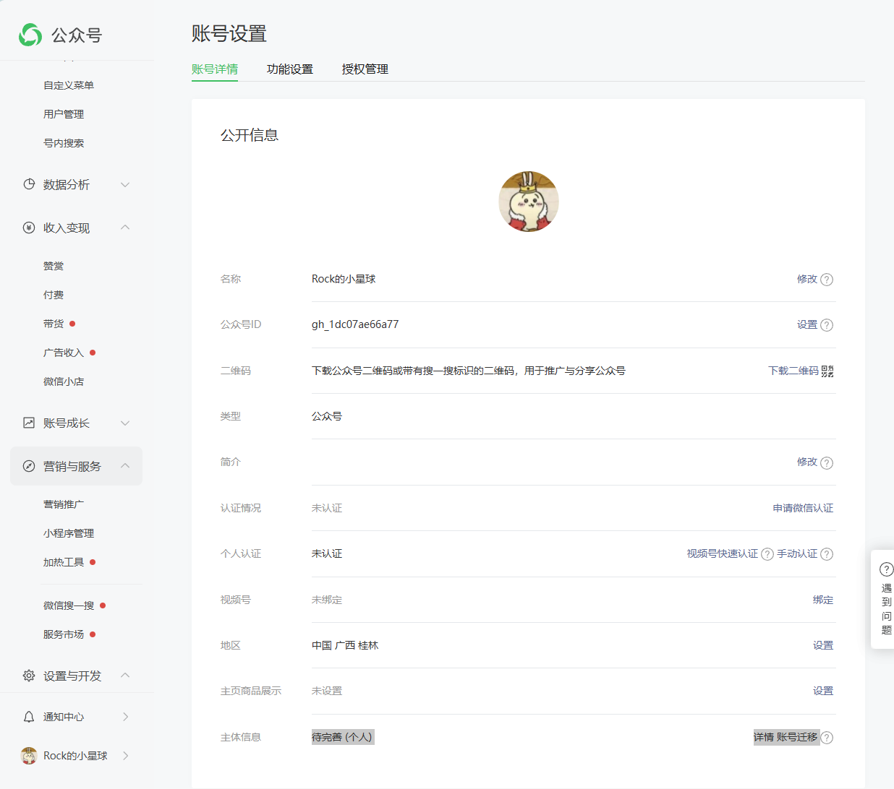
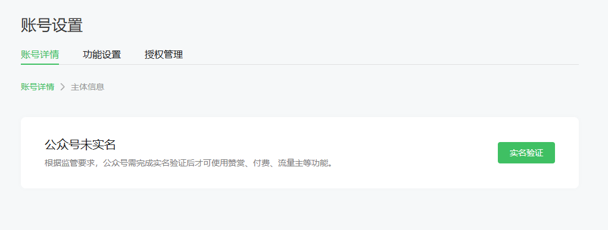
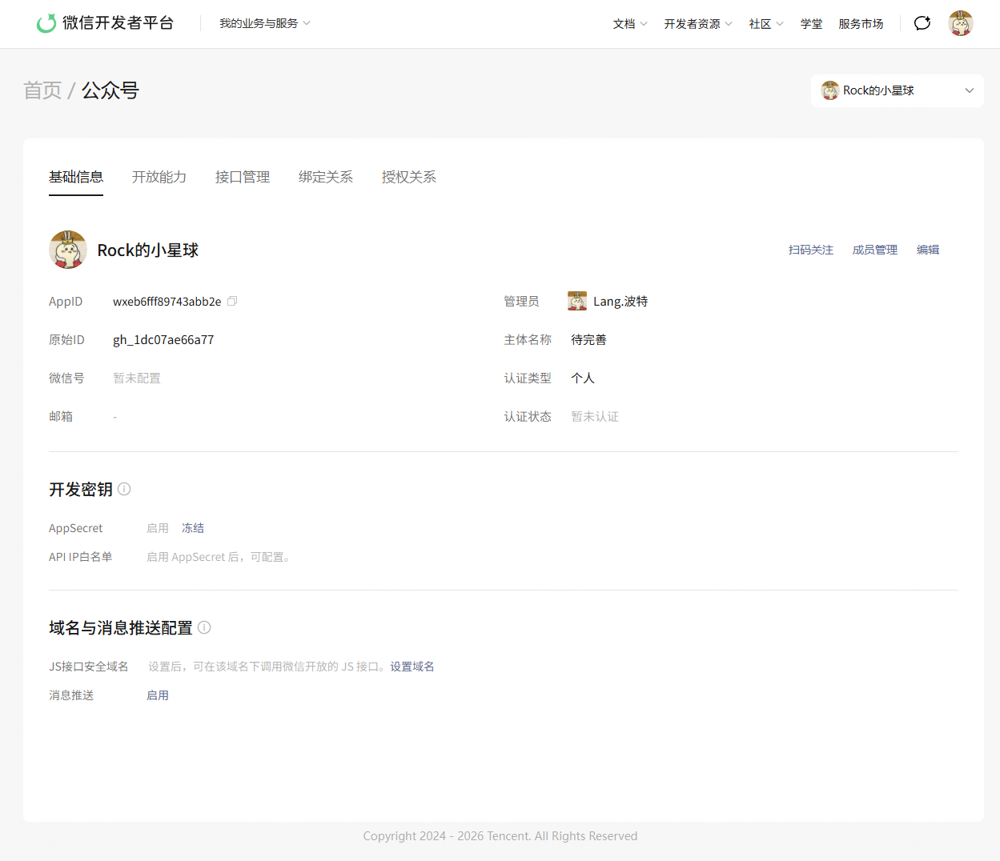
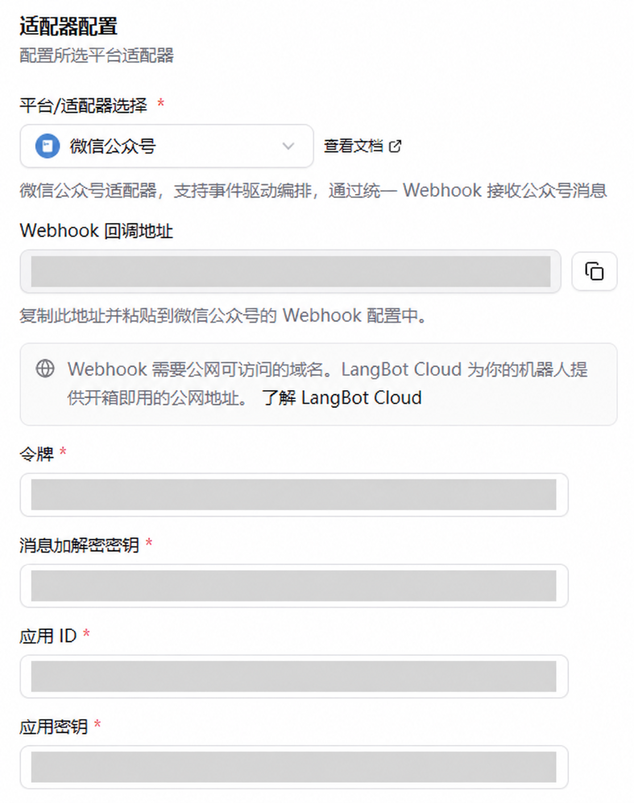
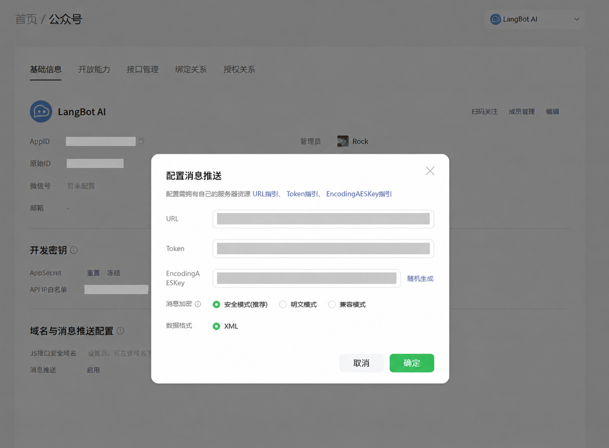

本教程使用微信公众平台完成账号注册和主体实名认证，在微信开发者平台配置应用密钥、消息推送和 API IP 白名单。

## 1. 注册公众号并完成主体实名认证

进入[微信公众平台](https://mp.weixin.qq.com/)。已有公众号可直接扫码登录；尚未注册时，点击「立即注册」，选择「公众号」，按提示完成注册。

进入「设置与开发 → 账号设置 → 账号详情」，找到页面底部的「主体信息」，点击「详情」。如果显示「待完善」，请先完成主体信息。

在主体信息页面点击「实名验证」，按照微信提示完成实名认证。

<Note>
这里需要完成的是「主体信息」中的实名验证。账号详情中还有「申请微信认证」「个人认证」等入口，请按截图进入主体信息页面操作。
</Note>

## 2. 获取应用信息并创建 LangBot 机器人

前往[微信开发者平台](https://developers.weixin.qq.com/platform)，进入公众号设置，选择要接入的公众号，打开「基础信息」。页面包含 AppID、「开发密钥」以及「域名与消息推送配置」。

在 LangBot 中新建机器人，选择「微信公众号」适配器，进入机器人配置页：

1. 复制微信开发者平台中的 **AppID**，填写到 LangBot 的「应用 ID」。
2. 在微信开发者平台的「开发密钥」区域点击 AppSecret 的「重置」，按提示获取密钥，填写到 LangBot 的「应用密钥」。首次使用时，如果按钮显示为「启用」，先按提示启用 AppSecret。
3. 点击 LangBot 的「保存并启用」，保存机器人并启用。

下面是 LangBot 适配器配置区域。图中的「令牌」和「消息加解密密钥」会在下一步与微信平台一起配置。

## 3. 启用消息推送并配置回调

回到微信开发者平台，在「基础信息」页面下方的「域名与消息推送配置」区域，点击「消息推送」旁的「启用」。

在「配置消息推送」弹窗中按以下顺序填写，暂时不要点击「确定」：

1. **URL**：复制 LangBot 机器人配置页显示的完整「Webhook 回调地址」并粘贴。地址通常为 `https://你的域名/bots/机器人UUID`，请保留完整路径。
2. **Token**：自行设置一个符合微信页面要求的 Token，并将同一个值填入 LangBot 的「令牌」。两边必须完全一致。
3. **EncodingAESKey**：点击微信平台的「随机生成」，复制生成的值，填入 LangBot 的「消息加解密密钥」。
4. **消息加密**：选择「安全模式（推荐）」。
5. **数据格式**：选择 **XML**。

两个平台的配置对应关系如下：

| 微信开发者平台 | LangBot |
| --- | --- |
| AppID | 应用 ID |
| AppSecret | 应用密钥 |
| URL | Webhook 回调地址（从 LangBot 复制） |
| Token | 令牌 |
| EncodingAESKey | 消息加解密密钥 |

保持微信平台弹窗开启，回到 LangBot **再次保存机器人**。确认机器人已启用且配置成功应用后，再回到微信平台点击「确定」。微信会访问回调地址进行验证，通过后消息推送配置即完成。

<Tip>
Webhook 回调地址需要能够从公网访问，建议使用 HTTPS。自部署可参考[配置 HTTP 反向代理和 SSL](/zh/workshop/production/proxy-and-ssl)，将公网域名转发到 LangBot 服务。使用 HTTP 时需使用 80 端口，HTTPS 使用 443 端口。

如页面显示的仍是本地地址，请将实例 `data/config.yaml` 中的 `api.webhook_prefix` 设置为公网地址，例如 `https://bot.example.com`，重启 LangBot 后重新复制回调地址。[LangBot Cloud](https://space.langbot.app/cloud) 提供可直接使用的公网回调地址。
</Tip>

### 常见错误：请求失败，HTTP 返回非 200

如果点击微信平台的「确定」后出现此提示，请依次检查：

- **URL 正确且公网可达**：使用 LangBot 显示的完整回调地址，包含 `/bots/机器人UUID`。本机地址、内网地址或仅填写域名首页均不能作为此机器人的回调地址。
- **机器人已保存并启用**：填写 Token 和 EncodingAESKey 后，需要先在 LangBot 保存，再在微信平台确认。
- **字段一致**：Token、EncodingAESKey 必须与 LangBot 完全一致；AppID、AppSecret 必须属于当前选择的公众号，复制时不要带入多余空格或换行。
- **转发配置有效**：检查反向代理或隧道是否仍在运行、HTTPS 证书是否有效，以及回调是否被登录验证或访问控制拦截。

旧界面可能显示「系统发生错误，请稍后重试」，同样可以按上述项目检查，并查看 LangBot 的机器人日志定位错误。

### 启用消息推送后，自定义菜单显示「未开启自定义菜单」

启用「消息推送」（服务器配置）后，公众号进入开发者模式。微信会停用在公众平台网页里编辑的自定义菜单，并在「自定义菜单」页面提示「由于开发者通过接口修改了菜单配置，当前菜单配置已失效并停用」。这是微信平台的规则，LangBot 不会主动修改或删除你的菜单。

继续使用 LangBot 时，在 LangBot 中重新发布菜单即可（见下方[自定义菜单](#自定义菜单)）。如果停用消息推送，网页编辑的菜单可以恢复，但 LangBot 将无法再收到公众号消息。

## 4. 配置 API IP 白名单

在微信开发者平台「基础信息 → 开发密钥」中找到 **API IP 白名单**，填入部署 LangBot 的服务器访问微信 API 时使用的**公网出站 IP**，保存配置。截图中未启用 AppSecret 时，该项会提示「启用 AppSecret 后，可配置」。

可以从服务器或云平台的网络配置中查找出站 IP。如果 LangBot 通过 NAT 网关或代理访问微信 API，应填写实际出口的公网 IP；存在多个出口时，按微信页面要求将它们加入白名单。

<Note>
回调 URL 用于微信向 LangBot 推送事件；API IP 白名单用于 LangBot 调用微信接口。使用反向代理或 Cloudflare Tunnel 提供回调地址时，白名单仍应填写 LangBot 访问微信 API 的出站 IP，而不是回调域名解析出的 CDN 地址。
</Note>

## 接入模式与后续使用

在新版「微信公众号」适配器的「接入模式」中选择回复方式，保存后生效。已有机器人不会自动切换模式；默认值仍为 `drop`。旧版适配器不提供 `auto`，请使用新版适配器。

| 接入模式（Mode） | 回复机制 | 适用场景 |
| --- | --- | --- |
| `auto` | 先返回加载提示，后台生成回复；通过客服接口发送，受限时改为下一条消息领取。 | 希望生成完成后直接收到回复，或不确定账号是否具有客服接口权限。 |
| `passive` | 先返回加载提示，后台生成回复；用户再发任意内容领取，不调用客服接口。 | 没有客服接口权限，或希望始终使用领取方式。 |
| `drop`（默认） | 在当前微信回调内直接返回回复，不调用客服接口，也不会自动转为领取方式。 | 能在 5 秒内完成的快速回复；不适合耗时较长的 AI 生成。 |

### auto 如何自动选择回复方式？

`auto` 不会预先查询或要求填写账号认证状态，而是在处理器发送回复时，根据微信客服接口的实际返回结果决定：

1. 收到用户消息后，先返回加载提示，处理器在后台继续运行。
2. 处理器生成并发送回复时，LangBot 尝试调用客服接口。成功后，用户直接收到回复，不必再发消息领取。
3. 微信明确返回无接口权限（`48001`）、超过回复时限（`45015`）、下发额度用尽（`45047`）或接收者未关注（`43004`）时，LangBot 缓存回复。用户随后向公众号发送任意内容，即可通过这次回调领取。

这个判断针对每次回复，不会把账号永久标记为“无权限”。AppID、AppSecret、IP 白名单错误以及网络异常等其他失败会记录报错，不会一律当作权限不足并回退。收到加载提示只能说明消息已进入处理流程；排查未收到回答时，还需要查看处理器执行日志。

### 认证与回复窗口有什么关系？

**被动回调和客服消息是两种不同的回复渠道。** 微信要求被动回调在 **5 秒内**响应；认证不会延长这个时间。`drop` 使用的就是被动回调，不能把微信重试当成稳定的 15 秒生成窗口。[被动回复官方说明](https://developers.weixin.qq.com/doc/service/guide/product/message/Passive_user_reply_message.html)

客服接口允许在回调结束后发送回复。微信官方当前标明，公众号、服务号需企业主体已认证才能调用；前文的「主体实名验证」不等于取得客服接口权限。具体以账号实际权限和微信接口返回为准。

| 用户操作 | 客服消息下发额度 | 有效期 |
| --- | --- | --- |
| 发送消息 | 5 条 | 48 小时 |
| 点击符合条件的自定义菜单、关注、扫描二维码 | 3 条 | 1 分钟 |

这些是微信客服接口的限制，不是 AI 的生成超时设置，也不是所有事件都享有 48 小时窗口。规则可能调整，请以[微信客服消息官方文档](https://developers.weixin.qq.com/doc/service/api/customer/message/api_sendcustommessage)为准。

### 如何领取回复和设置加载提示？

在 `passive` 或 `auto` 回退后，用户发送的下一条消息用于领取上一轮回答，**不会同时作为新的问题交给处理器**。如果回答尚未生成，仍会返回加载提示；稍后再发送任意内容即可。领取完成后，再发送新的问题。

`LoadingMessage` 对 `auto` 和 `passive` 都有效，对 `drop` 无效。可以按模式修改，例如：

- `auto`：「正在处理，请稍候。若未收到回复，请稍后发送任意内容领取。」
- `passive`：「AI 正在思考中，请稍后发送任意内容获取回复。」

将加载提示留空时，LangBot 只向微信确认接收，不发送可见的加载消息。待领取回复保存在内存中，重启 LangBot 或重新加载机器人配置会清空，因此请在修改配置后重新发起对话。三种模式仍受微信消息内容和长度限制。

### 连接处理器

完成平台配置后，在 LangBot 的「事件路由」中将「收到消息」连接到需要使用的流水线、Agent 或插件处理器，再关注公众号并发送消息。

接入模式只决定回复如何送达，不会自动把 Agent 的所有文本输出发送到微信。使用 Agent 时，请批准「回复当前会话」工具，并在指令中要求使用该工具回复；使用插件处理器时，需要插件调用回复接口。

## 自定义菜单

新版「微信公众号」适配器的机器人详情页提供「自定义菜单」标签页，可以直接编辑并发布公众号聊天窗口底部的菜单：

1. 确认机器人已启用，并已按上文配置 API IP 白名单。
2. 打开机器人详情页的「自定义菜单」标签页。原来在公众平台网页里配置过菜单的，点击「从公众平台导入」即可把被停用的菜单原样读回来，导入的菜单会立即保存到 LangBot。
3. 在「菜单结构」中点击要编辑的按钮，在「按钮设置」中修改名称和点击后的动作。一级菜单和子菜单都可以在「菜单结构」中添加、用箭头调整顺序或删除。点击左侧手机预览中的按钮可以看到用户点击后的效果。
4. 点击「保存并同步到公众号」。菜单会先保存到 LangBot，再整体替换公众号上的菜单，用户通常需要几分钟或重新进入公众号后才能看到新菜单。机器人未启用或还有按钮未填写完整时，只保存到 LangBot，不同步。

最多 3 个一级菜单，每个一级菜单下最多 5 个子菜单；一级菜单名称不超过 16 字节，子菜单名称不超过 60 字节（一个汉字约 3 字节）。按钮点击后的动作：

| 动作 | 效果 |
| --- | --- |
| 打开网页 | 跳转到指定网址。 |
| 打开小程序 | 跳转到已关联小程序的页面；不支持小程序的旧版客户端打开备用网页。 |
| 回复固定文字 | 立即回复预设内容，不调用 AI。 |
| 让 AI 回复 | 相当于用户发送一句预设的话，由当前的聊天流水线或 Agent 回复。 |
| 触发事件（高级） | 产生 `platform.specific` 事件（`officialaccount.CLICK`），`data.EventKey` 为按钮的事件 Key。在事件路由中添加绑定并按 `data.EventKey` 过滤，即可交给 Agent 或插件处理。 |

公众平台网页中的图文、图片、语音、视频等素材按钮无法通过接口导入，导入后会标记为「不支持的类型」，需要改为其他动作后才能同步到公众号。

同步失败时，页面会显示微信返回的错误码及说明。常见原因：服务器出网 IP 不在 API IP 白名单（`40164`）、账号没有自定义菜单接口权限（`48001`，未认证的订阅号通常没有）、小程序未与公众号关联（`85005`）。

<Note>
插件和 Agent 也可以通过 `call_platform_api` 调用 `menu.get`、`menu.import_console`、`menu.publish`、`menu.delete` 管理菜单。旧版适配器没有菜单编辑器，请切换到新版适配器后使用。
</Note>
