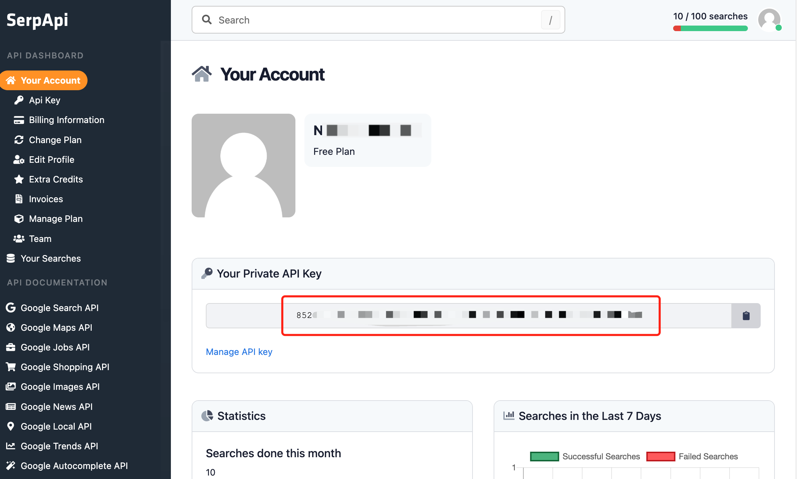

# GoogleSearch

เครื่องมือสำหรับทำการค้นหา Google SERP และดึงข้อมูลตัวอย่าง (snippets) และหน้าเว็บ อินพุตควรเป็นคำค้นหา

## วิธีใช้

ติดตั้งปลั๊กอิน จากนั้นตั้งค่า `api_key` ในการกำหนดค่าปลั๊กอิน
คุณสามารถรับ `api_key` ได้จาก [SERP API](https://serpapi.com/dashboard)

